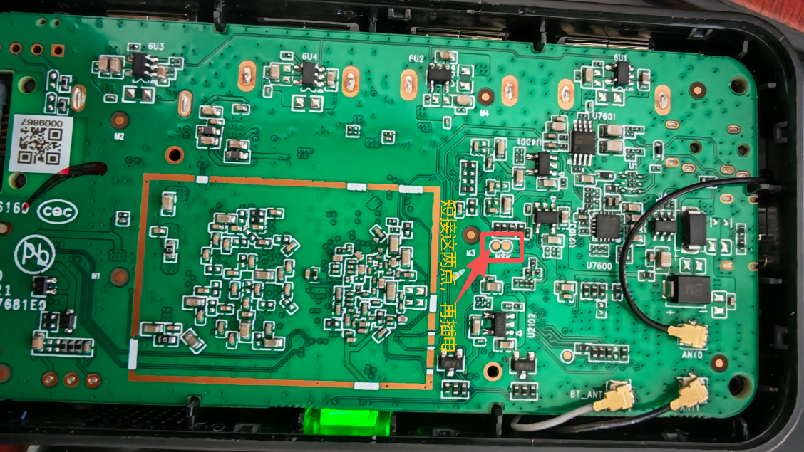
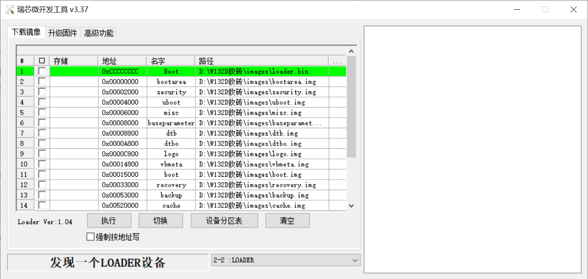
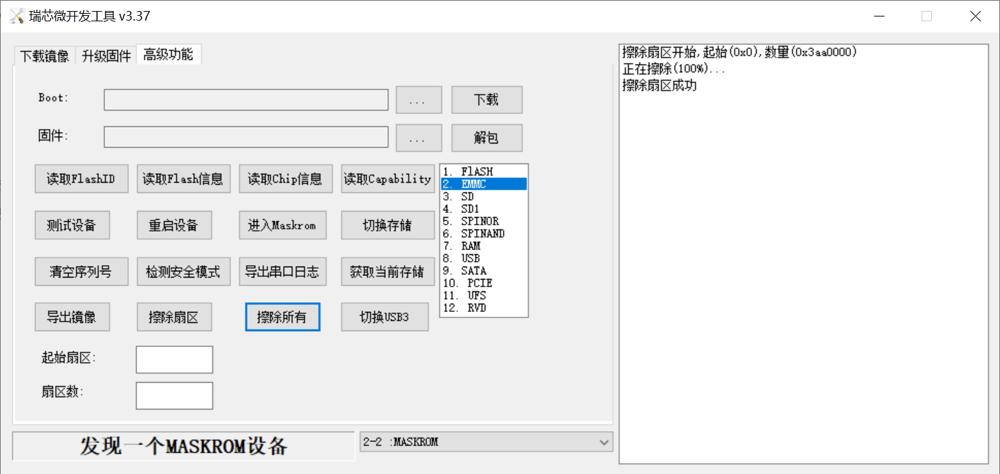

# 中兴 W132D 救砖：分区表被清空、绿灯长亮，一次刷回原厂

> 系列文章：[刷机篇：MaskROM 线刷飞牛 fnOS](https://www.320826.xyz/2026/11/w132d-fnos-maskrom.html) · 

## 目录

- [1. 写在前面](#1-写在前面)
- [2. 适用场景](#2-适用场景)
- [3. 一次刷完就够](#3-一次刷完就够)
- [4. 准备](#4-准备)
- [5. 第 1 步：进刷机模式](#5-第-1-步进刷机模式)
- [6. 第 2 步：刷机](#6-第-2-步刷机)
- [7. 第 3 步：开机](#7-第-3-步开机)
- [8. 第 4 步：恢复出厂设置（重要，只做一次）](#8-第-4-步恢复出厂设置重要只做一次)
- [9. 怎么判断刷成功了](#9-怎么判断刷成功了)
- [10. 20 行配置一览（别改，改错必黑屏）](#10-20-行配置一览别改改错必黑屏)
- [11. 下载整包](#11-下载整包)
- [12. 可选：刷当贝桌面版](#12-可选刷当贝桌面版)
- [13. 配图清单与素材来源](#13-配图清单与素材来源)
- [14. 上传 GitHub 注意事项](#14-上传-github-注意事项)
- [15. 许可与免责](#15-许可与免责)

---

## 1. 写在前面

前两篇写了怎么把中兴 W132D 刷成飞牛 fnOS（[刷机篇](https://www.320826.xyz/2026/11/w132d-fnos-maskrom.html)）、以及刷完之后 [HDMI / USB / WiFi 怎么修](https://www.320826.xyz/2026/11/w132d-hdmi-usb-wifi.html)。但玩这类盒子总有个绕不开的环节：**玩脱了变砖怎么办**。

典型的翻车现场是刷别的系统（Armbian、各种 RK3528 固件）时把分区表清掉了——开机黑屏、绿灯长亮，看起来彻底死了。这台机器并没有真死：RK3528 的 MaskROM 是 SoC 内部固化的，只要还能被电脑认到，就能救回来。

这篇介绍的救砖包，就是把一台分区表被清空的 W132D 按地址整体写回 20 个原厂分区，恢复出厂可开机状态。**一次刷完，不用两步法，也不依赖工具去识别盘的容量。**

> ⚠️ 本包仅针对中兴云电脑 W132D（RK3528 / 2+32G / Android 9 / 纯 32 位 armeabi-v7a）。刷机有风险，写错地址或刷错机型可能变砖，风险自负。

## 2. 适用场景

| 现象                                        | 能不能救           |
| ----------------------------------------- | -------------- |
| 刷了飞牛 fnOS / Armbian 等，分区表被清空，开机黑屏、绿灯长亮不显示 | ✅ 本包就是为这个场景做的  |
| 分区表还在，只是 system 被写坏、进桌面后自动重启              | ✅ 整盘按地址写回即可    |
| 连 MASKROM 都进不去、电脑认不到任何 USB 设备             | ✅ 短接方案，下文有图有真相 |

## 3. 一次刷完就够

**20 个分区全都按绝对地址写**，工具只做「按地址写扇区」这一件事，中途不做容量校验，所以一次执行就能把整台机器写回原厂状态：

- `bootarea`（`0x0`）写回 MBR + GPT + IDB，这是分区表真正所在；
- 其余 18 个分区按原厂起始 LBA 依次写入；
- 跑完直接断电开机，首次启动会重建缓存，1~3 分钟进系统。

之前试过「只写 32KB GPT → 再刷整盘 sparse 包」的两步法，卡在 `unsparse size is larger than partition, partition=0`：工具读不到盘容量，整盘包那一行永远过不去。本包放弃了那套方案，改成全区写回——稳定，且不依赖工具的容量识别。

## 4. 准备

- Windows 10 / 11，D 盘空闲 **≥ 12 GB**（镜像合计约 10.7 GB）；
- **一根双公头 USB 线**——没有就自制，找两个数据线剪断，按颜色对接，最好同样的线，防止颜色不对接错；
- 没在这台电脑刷过瑞芯微设备，先运行一次 `驱动/DriverInstall.exe`；
- 建议插**主机后置 USB 口**，不要经过 hub / 延长线。

## 5. 第 1 步：进刷机模式

断电 → 捅住复位孔（或短接）→ 插 USB → 松手。工具下方出现「**发现一个 MASKROM 设备**」或「发现一个 LOADER 设备」才算连上。

短接手法的要诀：**先短接，再上电，1~2 秒后松开**，不要长时间按住不放。

短接点如图（红框与箭头标注处即短接点，橙色框为主板上的对应区域）：

## 6. 第 2 步：刷机

下载的压缩包**解压到 D 盘根目录，必须是 D 盘根目录**，配置已经写死了，不然 20 行数据要重配置。

1. 双击 `RKDevTool刷机工具/RKDevTool.exe`，表格里自动就是 20 行（Boot + bootarea + 18 个分区）；
2. 勾选**「强制按地址写」**，点「执行」；
3. 全程约 4~5 分钟，日志逐行滚动，最后出现 `RunProc is ending, ret=1`；
4. 如果出错先清空一遍：在「高级功能」页选 `EMMC`，点「擦除所有」，右侧日志出现 `擦除扇区成功` 后再重刷。

## 7. 第 3 步：开机

拔 USB，接电源与 HDMI。首次开机会重建缓存，等 1~3 分钟，**中途不要断电**。

## 8. 第 4 步：恢复出厂设置（重要，只做一次）

刷完进系统后，走 `设置 → 系统 → 恢复出厂设置`（或恢复模式里的 `Wipe data / factory reset`），**会要求输入密码，默认密码是 10086**。

这一步不是可有可无的：它让系统把 20.24 GiB 的 `userdata` 分区重新格式化。本包的 `userdata.img` 只有 2 GiB（ext4），刷完系统只会显示 2~8 GiB，做一次恢复出厂就撑满整块分区，之后不用再做。

## 9. 怎么判断刷成功了

只有一条标准：**每行 `Download ...` 后面没有紧跟 `Error:`**。

- `RunProc is ending, ret=1` 不是失败，只是「重启设备」这个动作没成，数据已经写完；
- 关键几行要有：`bootarea (100%)`、`system 0x009ED000`（约 80 秒）、`userdata`；
- 刷完还是黑屏 / 绿灯长亮：先确认 `bootarea` 那行是 100% 且无 `Error:`。

## 10. 20 行配置一览（别改，改错必黑屏）

工具表格里就是这 20 行，随包的 `config.cfg` 里存的就是它。地址是**扇区号（LBA）**，不是字节偏移，单位 512 字节，合计写入约 10.7 GB。

| #   | 名字              | 地址           | 镜像                                                     | 大小        |
| --- | --------------- | ------------ | ------------------------------------------------------ | --------- |
| 1   | `Boot`          | `0xCCCCCCCC` | `loader.bin`                                           | 465,344 B |
| 2   | `bootarea`      | `0x00000000` | `bootarea.img`（MBR + GPT + IDB）                        | 4 MB      |
| 3   | `security`      | `0x00002000` | `security.img`                                         | 4 MB      |
| 4   | `uboot`         | `0x00004000` | `uboot.img`                                            | 4 MB      |
| 5   | `misc`          | `0x00006000` | `misc.img`                                             | 4 MB      |
| 6   | `baseparameter` | `0x00008000` | `baseparameter.img`                                    | 1 MB      |
| 7   | `dtb`           | `0x00008800` | `dtb.img`                                              | 4 MB      |
| 8   | `dtbo`          | `0x0000A800` | `dtbo.img`                                             | 4 MB      |
| 9   | `logo`          | `0x0000C800` | `logo.img`                                             | 16 MB     |
| 10  | `vbmeta`        | `0x00014800` | `vbmeta.img`                                           | 1 MB      |
| 11  | `boot`          | `0x00015000` | `boot.img`                                             | 60 MB     |
| 12  | `recovery`      | `0x00033000` | `recovery.img`                                         | 64 MB     |
| 13  | `backup`        | `0x00053000` | `backup.img`                                           | 2.40 GB   |
| 14  | `cache`         | `0x00520000` | `cache.img`                                            | 2.40 GB   |
| 15  | `system`        | `0x009ED000` | `system.img`（`0x666800` 扇区 = 3.2 GiB）                  | 3.20 GB   |
| 16  | `metadata`      | `0x01053800` | `metadata.img`                                         | 16 MB     |
| 17  | `vendor`        | `0x0105B800` | `vendor.img`                                           | 400 MB    |
| 18  | `oem`           | `0x01123800` | `oem.img`                                              | 256 MB    |
| 19  | `ctc`           | `0x011A3800` | `ctc.img`                                              | 256 MB    |
| 20  | `userdata`      | `0x01223800` | `userdata.img`（分区到 `0x3A9FFDE`，共 20.24 GiB；镜像本身 2 GiB） | 2.00 GB   |

存储里显示的容量来自 `/data` 的文件系统，不是分区大小——这也是为什么刷完必须做一次恢复出厂（见上文）。`bootarea.img` 内 GPT 头部信息：`my_lba=1`、`alt_lba=0x3A9FFFF`、`entry_lba=2`、`n_ent=128`、`ent_sz=128`，头部 CRC `CC498D5B`，整盘容量 `0x3AA0000` 扇区（29.36 GiB）。

## 11. 下载整包

123 云盘（9.9 元，知识付费）：

**<https://1853261401.share.123pan.cn/123pan/q6HYvd-OL6nv>**

> ⚠️ **必须解压到 D 盘根目录**，解压后必须是 `D:\W132D救砖\`，目录名一个字都不能改，也不能放桌面或 `D:\下载\` 这类子目录里。
> 原因：`config.cfg` 里写的是**绝对路径**，路径一变，工具打开就是 20 行全红、文件找不到。

## 12. 可选：刷当贝桌面版

砖救回来之后可下载这个包刷当贝桌面版：

<https://1853261401.share.123pan.cn/123pan/q6HYvd-PSysv>

## 13. 许可与免责

> 本包仅供个人救砖使用。刷机有风险，重要数据先备份。

